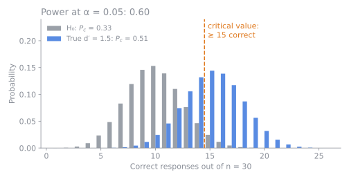

# Hypothesis tests and power

## Difference versus equivalence

Both tests are **one-tailed exact binomial tests** on the number of correct responses.
They differ in what you are trying to prove.

|                       | Difference test        | Equivalence test            |
| --------------------- | ---------------------- | --------------------------- |
| You want to show that | Products differ        | Products are similar        |
| Null hypothesis $H_0$ | $p_d \le p_{d0}$       | $p_d \ge p_{d0}$            |
| Alternative $H_1$     | $p_d > p_{d0}$         | $p_d < p_{d0}$              |
| Reject when           | Many correct responses | Few correct responses       |
| Typical `pd0`         | 0 (any difference)     | 0.2–0.3 (tolerated maximum) |

The two are not opposites. A non-significant difference test only means you lack
evidence of a difference; it does not demonstrate similarity. To argue for similarity
you need an equivalence test with a pre-declared threshold.

Under $H_0$ the probability of a correct answer is
$P_{c0} = P_g + (1 - P_g)\, p_{d0}$, so the number of correct responses follows
a binomial distribution with `n` trials and success probability $P_{c0}$.

## Power

**Power** is the probability that the test rejects $H_0$ when the products truly
differ by some d′. It depends on the panel size, the true d′, the significance level,
and the method.

The plot below shows the idea for a triangle test with 30 panelists. The grey bars are
the distribution of correct responses if the products were identical. The blue bars show
it when the true d′ is 1.5. The dashed line marks the smallest number of correct
responses that is significant at α = 0.05; the share of the blue distribution to the
right of the line is the power.

Several practical consequences follow:

- A larger panel narrows both distributions, so a given d′ becomes easier to detect.
- Methods with steeper psychometric functions (see
    [The Thurstonian model](thurstonian-model.md)) need fewer panelists.
- Equivalence tests are especially power-hungry, because the hypothesised d′ is small
    and the critical region sits in the lower tail.

To estimate power for your own design, see
[Estimate power by simulation](../how-to/estimate-power.md).
