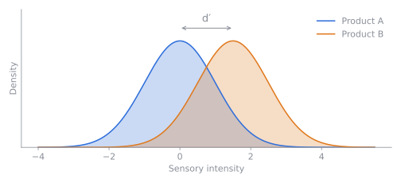
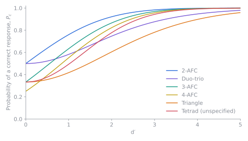

# The Thurstonian model

Raw proportions of correct answers are hard to compare across studies: 70% correct is
impressive in a triangle test, where guessing gives 33%, and mediocre in a 2-AFC test,
where guessing gives 50%. SensoPy therefore reports a method-independent measure of
sensory difference, **d′** (d-prime), taken from Thurstonian scaling.

## Sensory distributions

The model assumes each product produces a sensory intensity that varies from tasting
to tasting, following a normal distribution. The two products have the same spread
but different means, and d′ is the distance between the means in units of that spread.

When d′ is 0 the curves coincide and panelists can only guess. As d′ grows the curves
separate and the correct answer becomes easier to find.

## Psychometric functions

Each method asks a different question of the same sensory impression. A triangle
panelist must find the odd sample among three; a 2-AFC panelist chooses which of two
is stronger in a given attribute. Working out the probability of success under the
model gives each method's **psychometric function**, which maps d′ to the probability
of a correct response $P_c$.

Two features of the curves matter in practice:

- **They start at different places.** At d′ = 0 the curve equals the guessing
    probability $P_g$.
- **They climb at different rates.** For the same d′, 2-AFC yields a much higher
    $P_c$ than the triangle test. The triangle test is a harder task because the
    panelist compares three samples without being told which attribute to focus on, so
    it needs a larger d′ (or a larger panel) to reach the same power.

SensoPy estimates d′ from an observed proportion correct by inverting this function.

## Proportion of discriminators

A second measure, $p_d$, assumes a fraction of the panel can detect the difference and
the rest guess:

$$
P_c = P_g + (1 - P_g)\, p_d
\quad\Longleftrightarrow\quad
p_d = \frac{P_c - P_g}{1 - P_g}
$$

Unlike d′, $p_d$ does not depend on any assumption about the shape of the sensory
distributions, but it is tied to the method used.

## Further reading

See Bi (2015), chapter 2, for the derivations.
