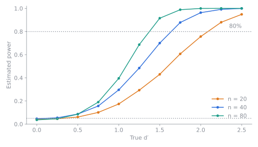

# Estimate power by simulation

Use `DiscriminationTest.simulate()` to find out how likely a planned test is to reach
significance for a given panel size, before you run it.

## Estimate the power of a difference test

Suppose you expect a true d′ of 1.5 and plan a triangle test with 50 panelists:

```python
from sensopy.discrimination import TRIANGLE, DiscriminationTest

test = DiscriminationTest(TRIANGLE)
sim = test.simulate(d=1.5, n=50, size=2000, rng=42)

print(f"power = {sim.power:.2f}")
```

```
power = 0.78
```

`simulate()` generates `size` experiments, tests each one, and reports the fraction
that reject the null hypothesis. Pass `rng` (an integer seed or a
`numpy.random.Generator`) for reproducible results.

## Find the panel size you need

Loop over candidate sizes and pick the smallest that reaches your target power:

```python
for n in (30, 50, 70, 90):
    power = test.simulate(d=1.5, n=n, size=2000, rng=42).power
    print(n, round(power, 2))
```

The figure below shows how power grows with both d′ and panel size for the triangle
method.



## Estimate the power of an equivalence test

Set `kind="equivalence"` and the threshold `pd0`. Here the true d′ is 0.3 and the
panel has 100 people:

```python
from sensopy.discrimination import DiscriminationTest, TWO_AFC

sim = DiscriminationTest(TWO_AFC).simulate(
    d=0.3,
    n=100,
    size=2000,
    kind="equivalence",
    pd0=0.30,
    rng=1,
)
print(f"power = {sim.power:.2f}")
```

```
power = 0.35
```

Even for nearly identical products, 100 panelists give only about a one-in-three chance
of demonstrating equivalence at this threshold. Equivalence tests need large panels.

## Use the exact power from a completed test

`difference()` and `equivalence()` also return a `power` attribute, computed from the
binomial distribution at the *observed* proportion correct. It is useful as a rough
check but is not a substitute for planning power with a hypothesised d′.
